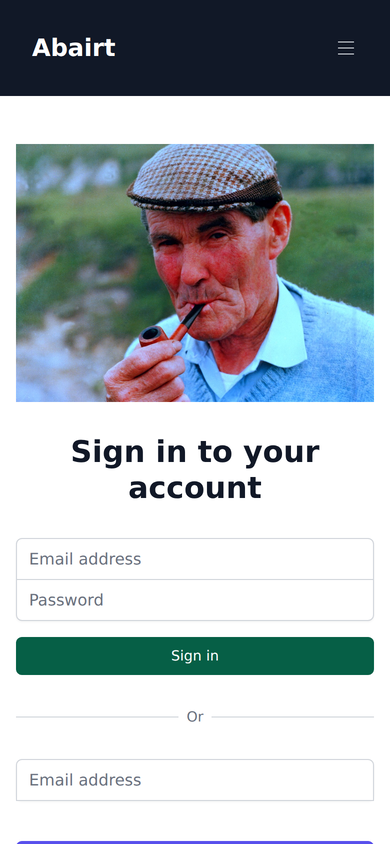
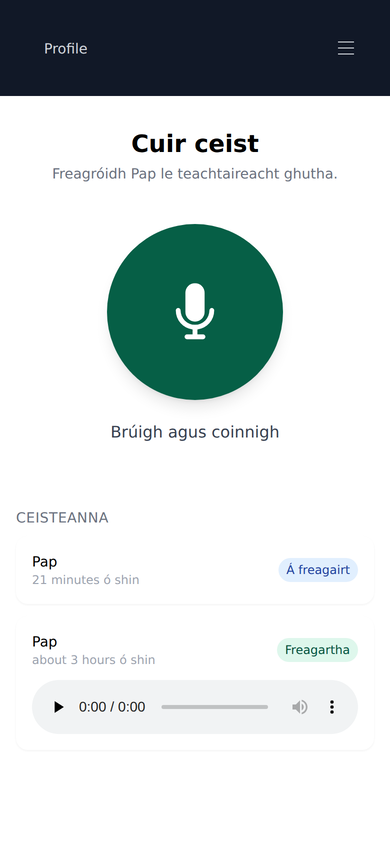
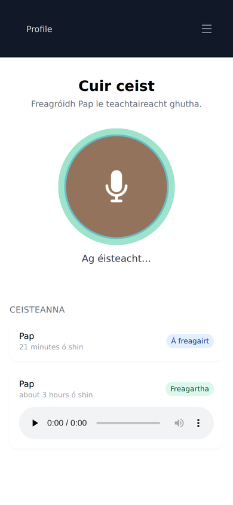
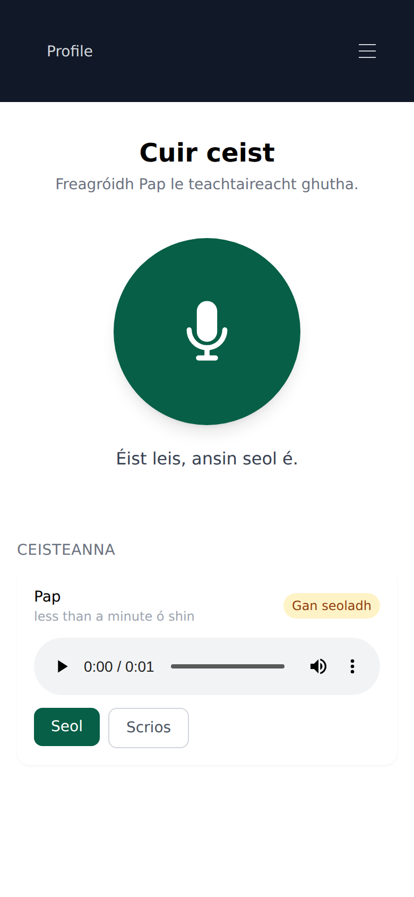
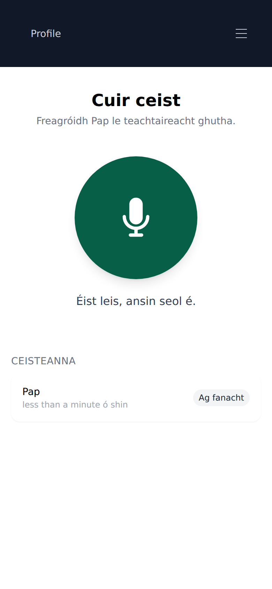
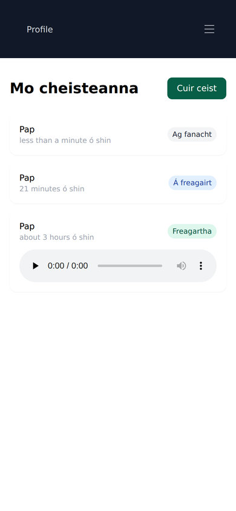
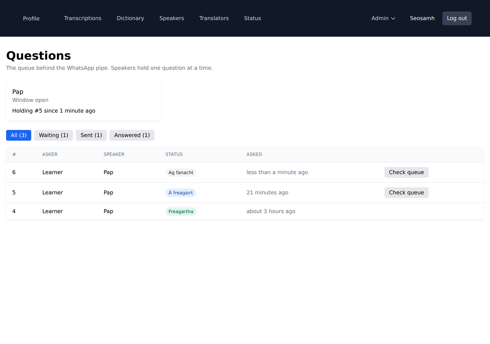

# WhatsApp questions

Learners record a question on the site. It reaches a native speaker as a
WhatsApp voice note. They hold the mic button and reply. That reply comes back
to the learner as the answer.

The speaker's entire interface is WhatsApp. They never see a web page, never log
in, never type a command. Everything below exists to keep it that way.

## The one rule

**A speaker holds one question at a time.** They are not sent a second question
until the first is answered.

This is not a throttle, it is what makes the whole thing work: because they are
only ever holding one question, whatever voice note they send back is
unambiguously the answer to it. No ids, no keywords, no quote-replying, nothing
for them to get wrong.

`QuestionQueue` is that rule, and it is the piece to be careful with.

## The pieces

| | |
|---|---|
| `Question` | asker, speaker, the question audio, the answer audio, status |
| `QuestionQueue` | one at a time — sends the next question if the speaker is free |
| `QuestionRouter` | picks the speaker with the shortest backlog |
| `Whatsapp::Client` | the four Cloud API calls this app makes |
| `Whatsapp::ProcessInbound` | decides whether an inbound message is an answer |
| `Whatsapp::DeliverQuestion` | sends a question, or nudges when the window is shut |
| `Whatsapp::AudioForWhatsapp` | guarantees ogg/opus |

## Two platform constraints that shape the design

**The 24 hour window.** WhatsApp only allows free-form messages — audio
included — within 24 hours of the speaker's last message to us. Outside it, the
only thing permitted is an approved template, and **templates cannot carry
audio**. So when the window is shut, `Whatsapp::DeliverQuestion` sends a nudge
template with a quick-reply button instead. One tap reopens the window and the
voice note follows immediately. The question stays `waiting` until the audio
actually goes out.

In practice a speaker who answers regularly keeps their own window open and
never sees a nudge.

**ogg/opus or nothing.** WhatsApp renders ogg/opus as a playable voice bubble
and every other format as a file attachment. A file attachment is a dead end for
an elderly user, so `Whatsapp::AudioForWhatsapp` is not optional. Browsers record
webm/opus, which is the same audio in a different container, so the usual case is
a stream copy rather than a re-encode. Requires `ffmpeg` with `libopus`.

## Setting it up

### 1. Credentials

Add under `whatsapp:` in `rails credentials:edit`, or as environment variables:

| Credential | Env var | What it is |
|---|---|---|
| `access_token` | `WHATSAPP_ACCESS_TOKEN` | System user token from Meta |
| `phone_number_id` | `WHATSAPP_PHONE_NUMBER_ID` | The business number's id |
| `app_secret` | `WHATSAPP_APP_SECRET` | Signs inbound webhooks |
| `verify_token` | `WHATSAPP_VERIFY_TOKEN` | Any string; used once at subscription |
| `api_version` | `WHATSAPP_API_VERSION` | Optional, defaults to `v23.0` |

#### Two numbers, and only one of them is special

| | |
|---|---|
| **The Abairt number** | The one the API owns and sends from. Dedicated — registering a number with the Cloud API requires deleting its consumer WhatsApp account first, so this can never be a line anyone uses personally. |
| **The speaker's number** | Entirely ordinary and entirely unchanged. They are a recipient: a voice note arrives from the Abairt contact in their normal WhatsApp and they hold the mic to reply. They register nothing with Meta and install nothing. |

Only the first one has a constraint. Nothing in this design asks a speaker to
change their number, their app, or anything else.

(Coexistence — one number on both the app and the API — does not help here. It
covers the WhatsApp *Business* app, not the consumer app that speakers use.)

The number has to be able to **receive** an SMS or a voice call, because that is
how Meta verifies ownership. Outbound-only virtual numbers cannot be registered
at all, VoIP numbers are hit and miss, and a data-only travel eSIM is no use —
it has no number that can take an SMS. A real mobile line, physical SIM or eSIM.

Make it an **Irish** number. Technically any country works and billing follows
the *recipient's* country code rather than ours, but a +353 number is the
difference between a voice note that looks like Abairt and one that looks like
spam — and until the display name is approved, the recipient sees the raw
number.

Prefer a **bill-pay** line over pay-as-you-go. Once the number is registered to
the Cloud API the SIM carries no traffic at all — every message goes out over
HTTP, not the cellular network — so to the carrier the line looks dormant from
day one and prepaid dormancy rules eventually reclaim it. A direct debit keeps
it alive without anyone remembering to. Losing the number means losing the
registration, and re-verifying is impossible once someone else holds it.

#### Testing before you buy a number

Meta's developer dashboard issues a free test number that sends and receives
normally, delivers webhooks, and reaches a handful of recipients you add and
confirm by code. That is enough to exercise the whole loop — signature checks,
inbound audio, the ogg/opus bubble, the one-at-a-time rule — against your own
phone or a friend's, with no SIM and no spend.

It is not a stand-in for the real thing: it is not the business identity, it
reaches only its allowlist, and templates made under it do not carry over, so
`ceist_nua` still needs submitting against the real number. Use it to prove the
plumbing, then buy the number for the pilot.

### 2. Webhook

Point the app's webhook at `https://abairt.com/api/whatsapp/webhook` and
subscribe to the `messages` field. Meta calls `GET` once with a challenge; the
app answers it from `verify_token`. Every `POST` after that is signature-checked
against `app_secret` and rejected if it does not match.

### 3. The nudge template

Submit a template named **`ceist_nua`** in Irish (`ga`) for approval, with a
quick-reply button. Approval is not instant and nothing outside the 24 hour
window works until it exists. Keep the text to one short line — many older
native speakers are fluent but read Irish slowly, so the words carry no content,
the button does the work.

### 4. The speaker

Created in admin by hand — they never fill in a form:

```ruby
User.create!(
  name: "...",
  phone_number: "353861234567",   # E.164, no +
  role: :speaker,
  answers_questions: true,
  whatsapp_opted_in_at: Time.current,
  confirmed: true
)
```

Meta requires demonstrable opt-in but does not care which channel it came
through, so consent gathered on a phone call is fine — record when and how.

Speakers have no email address and no password. There is nothing for them to
forget.

### 5. First run

Ring them, explain it, then send a test question yourself and stay on the phone
while they answer it. The first attempt has to succeed.

## The learner's side

Learners never touch WhatsApp. They install the site to their home screen and
hold one button.

The questions arrive spontaneously — mid-conversation, one hand free — so the
whole learner side is built around three actions: **tap the icon, hold the
button, let go** — then listen back and send.

* `/questions/new` is the one screen, and the PWA's `start_url`
* `voice_question_controller.js` is the press-and-release interaction. It
  auto-stops at 60 seconds and discards anything under 0.4s as a stray tap
* releasing the button records a **draft**, it does not send. The learner plays
  it back and then taps Seol or Scrios. A recording made one-handed is often not
  the question you meant to ask, and once a question costs credits, sending
  unheard is the wrong default. Sending is `POST /questions/:id/delivery`
* `/manifest` and `/service-worker` are what make the browser offer "Add to
  Home Screen". Their formats are pinned in `routes.rb` rather than negotiated
  off the Accept header, which is Rails' default and 500s for a client asking
  for `text/html`

### What it looks like

| | | |
|---|---|---|
|  |  |  |
| Password first, magic link below | The whole learner side | Held down |
|  |  |  |
| Play it back, Seol or Scrios | Queued once sent | Answers play in place |

The founder's view of the queue, at `/admin/questions` — who is holding what,
whether each speaker's 24 hour window is open, and a manual nudge:



### Passwords

A magic link is unusable on a phone mid-task — fetching a login link from email
is exactly the friction this is meant to remove. So:

* `has_secure_password validations: false` on `User`, because most users never
  get a password (speakers are created with only a phone number) and the magic
  link still works for everyone
* signing in sets a **permanent signed cookie** holding a `remember_token`.
  `Authentication#resume_session_from_cookie` uses it to repopulate
  `session[:user_id]`, so everything already reading the session is unchanged
* regenerating the token signs every device out; logout does this

Set one at `/password/edit` after signing in by magic link once.

## Watching it

`/admin/questions` shows the backlog, who is holding what, and whether each
speaker's 24 hour window is open. **Check queue** re-runs `QuestionQueue` for a
speaker by hand if something looks stuck.

Nothing chases a speaker who does not reply. A question sits as `sent`
indefinitely and shows up in admin. That is deliberate — no timeouts, no
reminders, no penalties.

## Debugging from the console

```ruby
speaker = User.answering.first
QuestionQueue.new(speaker).outstanding    # what they are holding
QuestionQueue.new(speaker).deliver_next   # send the next one, if they are free
speaker.whatsapp_window_open?             # can we send audio at all?
```
